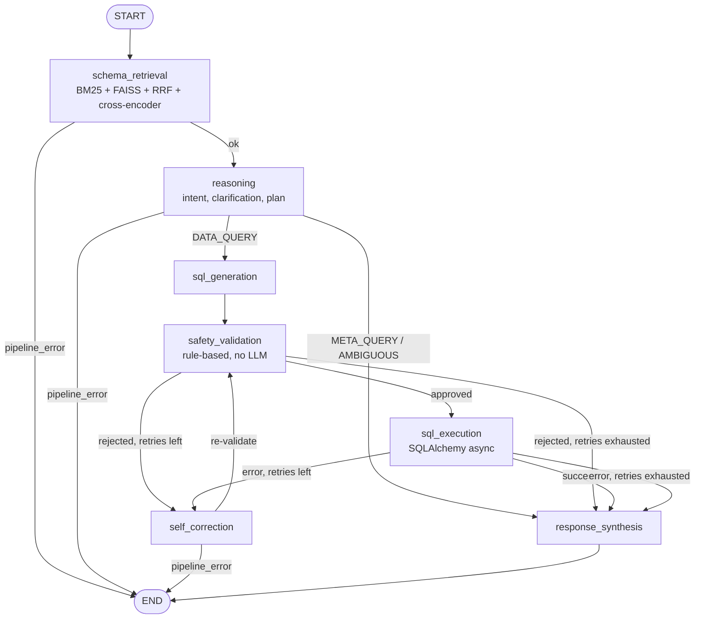

# Architecture

## Pipeline

The graph is built in `backend/graph/pipeline.py` (`build_pipeline`) from seven nodes in `backend/graph/nodes.py`, sharing a `PipelineState` (`backend/graph/state.py`). Edge labels below are the return values of the routing functions. Any node that sets `pipeline_error` routes straight to `END`.

GitHub renders this diagram natively on the [repository README](https://github.com/The-Harsh-Vardhan/ReasonSQL#architecture).

## Nodes

| Node | Type | What it does |
|------|------|--------------|
| `schema_retrieval` | deterministic | Loads table schemas. If the schema has at most `RAG_THRESHOLD_TABLES` (default 5) tables it uses all of them (`full_schema`); otherwise it runs hybrid retrieval (`hybrid_rag`). |
| `reasoning` | LLM (one call) | Batches four logical agents: intent analyzer (`DATA_QUERY`, `META_QUERY`, `AMBIGUOUS`), clarification agent (resolved query, assumptions, questions), query decomposer, query planner. For `AMBIGUOUS` it pre-fills the clarification questions as the final answer. |
| `sql_generation` | LLM | Generates PostgreSQL from the plan and schema context, with a default `LIMIT` and no `SELECT *`. |
| `safety_validation` | deterministic | Rejects `DROP`, `DELETE`, `INSERT`, `UPDATE`, `ALTER`, `CREATE`, `TRUNCATE` and `SELECT *`; appends `LIMIT` (default 100) if missing. |
| `sql_execution` | deterministic | Runs the approved SQL through SQLAlchemy async; records rows, timing or the error. |
| `self_correction` | LLM, conditional | Given the failed SQL and the error or safety violations, returns corrected SQL and a root cause. Increments `retry_count` (`MAX_RETRIES`, default 2). Output always goes back through `safety_validation`. |
| `response_synthesis` | LLM | Writes the final answer. Skips the LLM for `AMBIGUOUS` (questions already set). |

## Hybrid schema retrieval

Implemented in `backend/retrieval/hybrid_retriever.py`:

1. BM25 keyword search and FAISS semantic search (HuggingFace embeddings) each return `HYBRID_RETRIEVAL_K` candidates (default 10).
2. Reciprocal Rank Fusion merges the two ranked lists (`rrf_k = 60`).
3. A cross-encoder (`ms-marco-MiniLM-L-6-v2`) reranks the fused candidates.
4. The top `RERANKER_TOP_N` tables (default 5) become the schema context for the prompts.

## LLM providers

LangChain `.with_fallbacks()` chain: Gemini, then Groq, then Qwen2.5-Coder-32B via vLLM (opt-in, GPU). Prompts are `ChatPromptTemplate`s in `backend/llm/prompts.py`. LangSmith tracing is opt-in via `LANGCHAIN_TRACING_V2=true`.

## Deployment topology

Local: Docker Compose runs `postgres` (PostgreSQL 16 with pgvector, Chinook seeded) and `backend` (FastAPI on port 8000); the Next.js frontend runs separately. Hosted: Vercel (Next.js) calls Render (FastAPI), which executes against Supabase (PostgreSQL). See the [hosting guide](HOSTING).

## API

`POST /query`, `POST /query/stream`, `POST /feedback`, `POST /upload` (CSV), `GET/POST /databases`, `GET /databases/{id}/schema`, `GET /health`.
